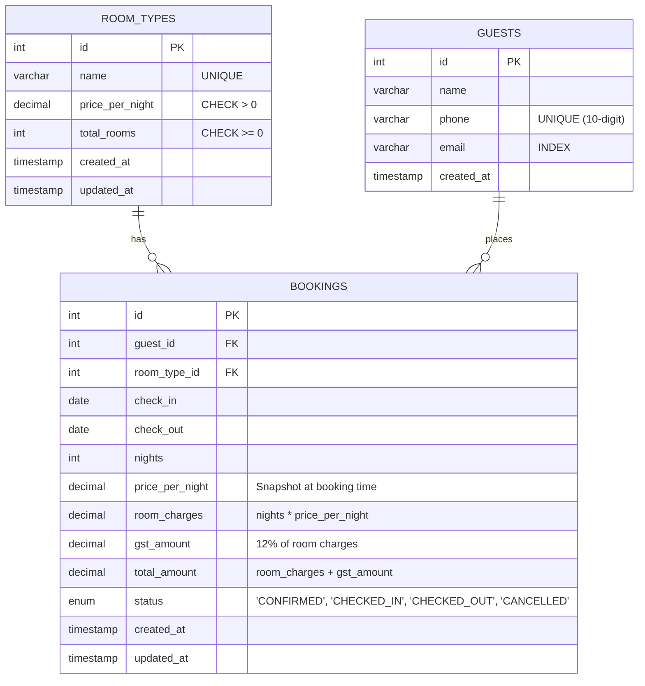

# StayDesk
Hotel Front Desk &amp; Booking Management

---

## 1. Project Documentation

### A. How to Set Up and Run Locally

#### Prerequisites
* Node.js v18+ (tested on Node v23)
* npm v9+
* MySQL 8.0.16+ (requires support for `CHECK` constraints)

---

#### 1. Backend Setup (`hotel-backend`)

```bash
# Navigate to backend directory
cd hotel-backend

# Install dependencies
npm install

# Configure environment variables
# Create a .env file (or copy from .env.example)
cat <<EOF > .env
PORT=5000
DB_HOST=localhost
DB_PORT=3306
DB_USER=your_mysql_user
DB_PASSWORD=your_mysql_password
DB_NAME=hotel_db
EOF

# Initialize Database Schema & Seeds in MySQL
mysql -u your_mysql_user -p hotel_db < database/schema.sql
mysql -u your_mysql_user -p hotel_db < database/seed.sql

# Start backend server in development mode
npm run dev
# Backend runs on http://localhost:5000
```

---

#### 2. Frontend Setup (`frontend`)

```bash
# In a new terminal, navigate to frontend directory
cd frontend

# Install dependencies
npm install

# Start frontend Vite development server
npm run dev
# Frontend runs on http://localhost:3000
```

> **Note:** Vite is configured to proxy all `/api` requests to `http://localhost:5000` automatically in development.

---

### B. Database Design

The relational schema uses MySQL 8.0.16+ with foreign keys, checks, and indexed constraints.



#### Tables Summary:
1. **`room_types`**: Stores room categories (e.g. Standard, Deluxe, Suite), nightly rates, and total room inventory.
2. **`guests`**: Stores customer details (`name`, `phone`, `email`). Phone number has a `UNIQUE` constraint to reuse existing profiles for returning guests (`ON DUPLICATE KEY UPDATE`).
3. **`bookings`**: Stores reservations with snapshot pricing, financial breakdown (`room_charges`, 12% `gst_amount`, `total_amount`), and lifecycle status (`CONFIRMED` ➔ `CHECKED_IN` ➔ `CHECKED_OUT` or `CANCELLED`).
4. **Concurrency & Double-Booking Protection**:
   * Uses MySQL transactions with row-level locks (`SELECT ... FOR UPDATE`) on the target room type during booking creation.
   * Confirms room availability across every single night of the requested date range before committing.

---

### C. Deployment Steps on Vercel

#### Deploying Frontend on Vercel:
1. Push repository to GitHub.
2. Log in to [Vercel](https://vercel.com/) and click **"Add New Project"** ➔ Import repository.
3. In **Project Settings**:
   * **Root Directory**: `frontend`
   * **Framework Preset**: `Vite`
   * **Build Command**: `npm run build`
   * **Output Directory**: `dist`
4. In **Environment Variables**, add:
   * `VITE_API_URL` = `https://<your-backend-domain>/api`
5. Click **Deploy**.

#### Deploying Backend API:
* Deploy the Express API to **Vercel Serverless Functions** (using `vercel.json` rewrite routing to `src/app.js`), **Render**, or **Railway**.
* Configure environment variables on the hosting platform: `DB_HOST`, `DB_PORT`, `DB_USER`, `DB_PASSWORD`, `DB_NAME`, `PORT`.

---
